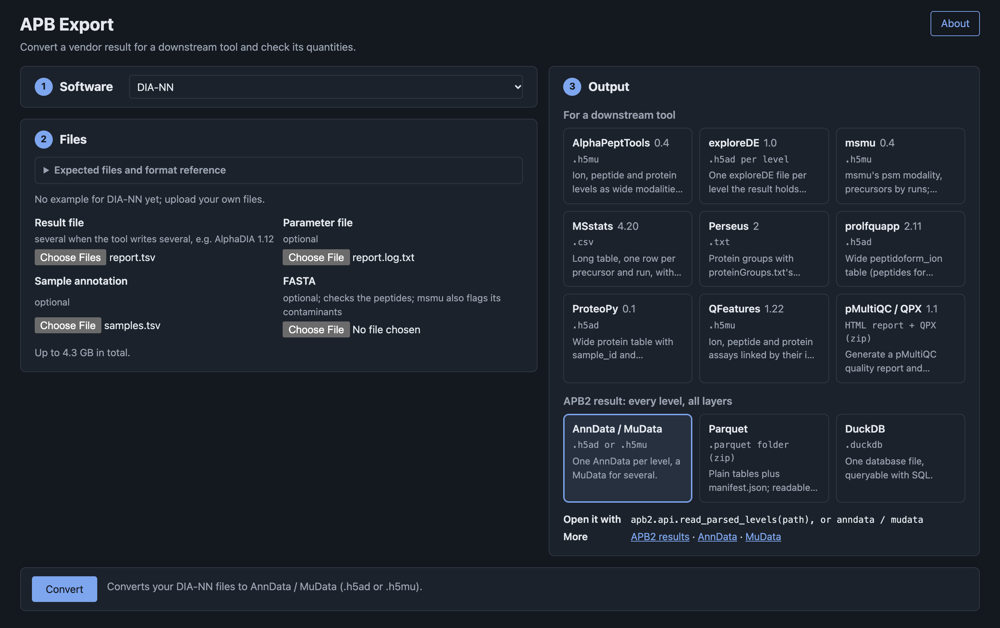
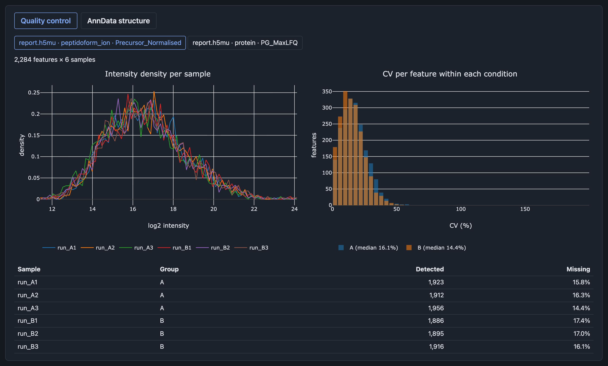

# APB Export UI

The upload page, server, job runner and QC presentation for [APB Export](https://github.com/anndata-omics-bridge/apb-export), released independently with a locked Python environment.

Documentation: [anndata-omics-bridge.github.io/apb-export-ui](https://anndata-omics-bridge.github.io/apb-export-ui/). Try it: [apps-dev.bfabric.org/apb-export](https://apps-dev.bfabric.org/apb-export/).





The screenshots show a synthetic DIA-NN 1.8.1 report: 600 made-up proteins, six runs, two conditions.

## Install on your computer

macOS and Linux, in a terminal:

```bash
curl -LsSf https://raw.githubusercontent.com/anndata-omics-bridge/apb-export-ui/main/launchers/install.sh | sh
```

Windows: download [install.bat](https://github.com/anndata-omics-bridge/apb-export-ui/blob/main/launchers/install.bat) and double-click it. macOS users who prefer Finder can use [install.command](https://github.com/anndata-omics-bridge/apb-export-ui/blob/main/launchers/install.command) after `chmod +x install.command`; Gatekeeper asks once, under System Settings → Privacy & Security.

The launcher installs [uv](https://docs.astral.sh/uv/) if it is missing, then this app from PyPI with Python 3.13, and opens http://127.0.0.1:8770. The first start downloads the 19 examples from [Zenodo](https://doi.org/10.5281/zenodo.24478242) (710 MB) into `~/APB-export/examples`; `apb-export-web start --no-examples` skips them. Run the launcher again, or `apb-export-web start`, to start the app later. Jobs stay in `~/APB-export` for 30 days. The install also provides the `apb2`, `apb-export` and `apb-fasta` commands. It has no pMultiQC yet, so **QPX** gives the tables without a report; the [hosted app](https://apps-dev.bfabric.org/apb-export/) and the [Docker image](docs/deploy.md#run-the-published-image) make the report.

## Run

`apb-export-web` without arguments shows help. Use `apb-export-web serve --help` for server options.

From a workspace checkout with the selected fixtures already downloaded through APB Studio:

```bash
uv sync --locked --group dev
uv run --locked apb-export-web examples build
uv run --locked apb-export-web serve
```

Open http://127.0.0.1:8770; stop the server with Ctrl-C. Stage examples once, then rerun staging when the inputs change.

Running `serve` again gracefully restarts a verified instance of this app on the same address. An unrelated listener is left running, and startup exits before changing the job store.

`examples build` defaults to `build/web-examples` and the parent APB workspace. Optional positional arguments are the destination directory followed by the workspace root.

The packaged [web selection](src/apb_export_ui/web/example_data/datasets.csv) includes two complete MaxQuant folders, FGCZ searches of the ProteoBench Q Exactive and Astral DDA samples with evidence, peptidoforms, peptides and protein groups. It excludes peptide-entrapment datasets. Acquire the selected fixtures through Studio's Fixture Manager before staging; both MaxQuant folders are in Studio's `apb_examples` inventory.

`examples build` also indexes the folder: `options.json` (software, outputs and the inputs each target takes, read once from its `--help`), `examples.json` and `previews/`. `examples index DIRECTORY` rewrites that index for a staged folder, an empty one included. `serve` only reads it: it finds `build/web-examples` in the current directory or its nearest parent, or takes a positional directory, and refuses a folder without an index or one indexed with other installed commits.

Python 3.13 is the tested interpreter; Node 22 is used only for frontend development and builds. The installed wheel serves its packaged assets without Node.

Where `apb-pmultiqc` is installed, as in the image and a development checkout, choose **pMultiQC / QPX** to generate a report immediately. Finished jobs offer **Open pMultiQC report** in a new tab, plus downloads for QPX tables, the HTML and a full report bundle. Sample groups are optional; retention times come through the exporter catalogue.

- [Web application](docs/web.md): uploads, examples, QC and job behavior
- [Deployment](docs/deploy.md): image build, migration and rollback
- [Dependency policy](docs/dependencies.md): locked APB releases and deliberate upgrades
- [Source baseline](docs/source-baseline.json): committed revisions recorded before extraction

## Development

```bash
make check
make check-full
```

`make check` runs Python quality gates, synthetic web tests, frontend tests and asset freshness, documentation links, and package validation. `make check-full` also installs the wheel into a fresh environment, runs a prefixed HTTP conversion, builds the image and tests it without source mounts. `make web` deliberately rebuilds the committed frontend bundle after a frontend change.

## Ownership

Distribution: `apb-export-ui`; Python namespace: `apb_export_ui`; executable: `apb-export-web`. Existing HTTP and persisted job interfaces remain supported; completed reports add an inline HTML route. Conversion stays in the installed `apb-export`, `apb2` and `apb-fasta` CLIs, and report execution in `apb-pmultiqc`; sibling Python imports use only their public API modules.

Extracted from APB Export commit `10e1166363259f7746c8d03d9bb4c11947118e0c`. This repository includes the original MIT license and attribution. Real example data remains external.
