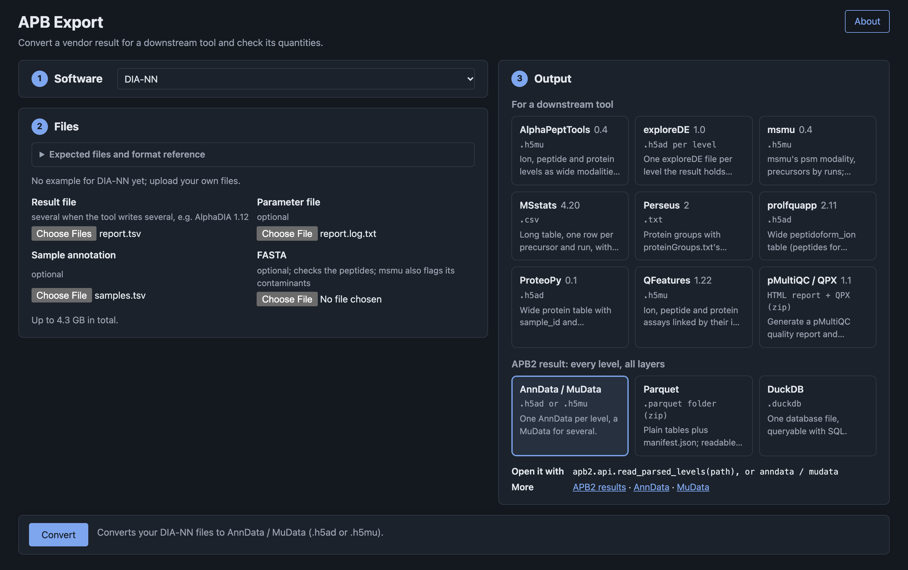
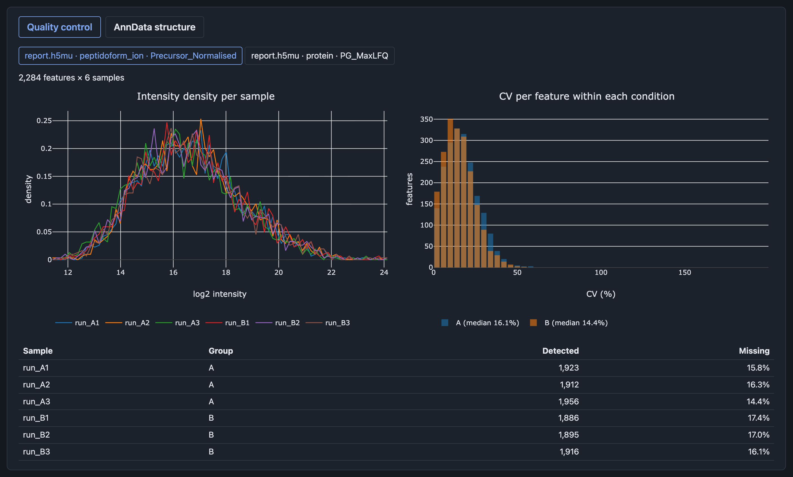

# APB Export UI

A web page that converts the result of a proteomics quantification tool into the file a downstream tool opens, and shows quality control before you download it. Conversion runs in the installed [APB Export](https://anndata-omics-bridge.github.io/apb-export/), [APB2](https://anndata-omics-bridge.github.io/apb2/) and [apb-fasta](https://anndata-omics-bridge.github.io/apb-fasta/); pMultiQC reports run in [apb-pmultiqc](https://github.com/anndata-omics-bridge/apb-pmultiqc).

Try it: [apps-dev.bfabric.org/apb-export](https://apps-dev.bfabric.org/apb-export/)

The screenshots show a synthetic DIA-NN 1.8.1 report: 600 made-up proteins, six runs, two conditions.

## Three steps



1. Software: the tool that wrote the result; the page then lists the files that tool writes
2. Files: the result, and optionally its parameter file, a sample annotation (SDRF or prolfquapp table) and a FASTA
3. Output: the file a downstream tool reads, or an APB2 result
    - Tools: AlphaPeptTools, exploreDE, msmu, MSstats, Perseus, prolfquapp, ProteoPy, QFeatures, pMultiQC / QPX
    - APB2 result: AnnData / MuData, Parquet or DuckDB

## Quality control



- One tab per level and quantity, such as precursors and proteins
- Intensity density per sample
- CV per feature within each condition of the sample annotation; across all samples without one
- Detected and missing counts per sample

## AnnData structure

![The AnnData structure tab for the precursor level: var columns, X with its primary quantity, four layers, obs with the sample annotation, and uns["apb"].](images/anndata-structure.png)

- For H5AD and H5MU results: each AnnData's X, layers, obs, var, aligned slots and `uns["apb"]`
- Drawn from the APB sidecar `<result>.apb.json` beside the result
- Each layer shows its shape, type, missing values and range

## Run it

```bash
uv sync --locked --group dev
uv run --locked apb-export-web examples build
uv run --locked apb-export-web serve
```

Open <http://127.0.0.1:8770>. The examples come from APB Studio's fixture store; see [Web application](web.md).

## More

- [Web application](web.md): uploads, examples, QC and job behavior
- [Deployment](deploy.md): image build, migration and rollback
- [Dependency policy](dependencies.md): immutable APB revisions and deliberate upgrades
- [MetaMorpheus example](metamorpheus-example.md): the complete IonStar table behind the web example
